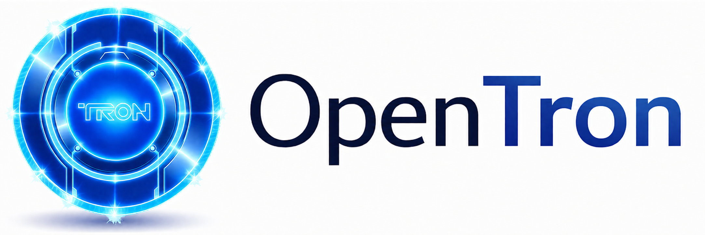
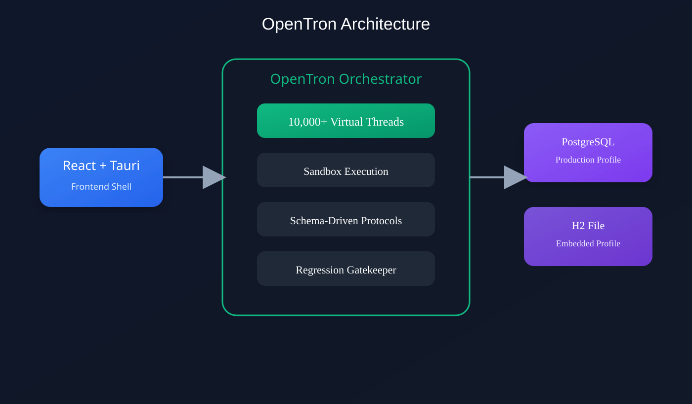
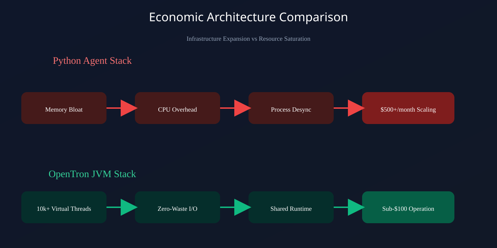

<p align="center">
  
</p>

<h1 align="center">Open Tron</h1>
<p align="center">
  <strong>Personal AI on Personal Devices | High-Density Java AI Agent Engine</strong>
</p>

<h3 align="center">
  How We Built a High-Density AI Agent Engine on a $1,000 Budget While Silicon Valley Burns Millions
</h3>

<p align="center">
  <a href="https://opentron.it.com">Website</a> •
  <a href="https://github.com/opentron-it-com/OpenTron/blob/main/benchmarks/OpenTron_Benchmark_Executive_Summary.pdf">Benchmarks (PDF)</a> •
  <a href="https://www.producthunt.com/products/opentron">Product Hunt</a>
</p>

---

## What is Open Tron?

**Open Tron** is a high-density, stateful multi-agent AI orchestrator built natively on **Java 21**, **Spring Boot**, and **PostgreSQL**. 

While mainstream AI frameworks rely on heavy Python runtimes (LangChain, CrewAI, AutoGen) that quickly encounter high RAM usage and operational complexity, Open Tron delivers enterprise-grade concurrency, high throughput, and low-latency agent orchestration on low-cost hardware.

### Project docs

- [Executive summary](EXECUTIVE_SUMMARY.md)
- [Developer architecture diagram](DEVELOPER_ARCHITECTURE.md)
- [REST API reference](API_REFERENCE.md)

---
# Ghostbook — Kiroween 2026 Devpost Write-up

## Submission links and readiness

- **Working app/demo URL:** Available in AWS link from hackathon submission.
- **Demo video:** https://www.youtube.com/watch?v=sW4fFDWKprM (public YouTube watch page; 14 seconds).
- **Public source repository:** https://github.com/opentron-it-com/Kiroween2026 (public github repo)
  Its GitHub license metadata is MIT.

## What it does

Ghostbook revives the personal digital organizer. You import exported notes, journals, and
records (CSV, PDF, DOCX, Markdown, plain text) into a haunted PDA-inspired workspace. The
OpenTron backend extracts and indexes them. You then ask the assistant natural-language
questions, and the workspace shows you both the answer and the specific archive passages that
match your question — with a clear disclaimer that displayed passages are search matches, not
a claim the model cited each one.

---

The demo flow: download the synthetic sample CSV archive from the page, import it, ask
"What did Mara and I watch at the Lantern Fair?" — the answer comes back and the Evidence
matches panel shows the exact excerpt from `ghostbook-sample-archive.csv`.
---

## 🏗️ Architecture & Core Mechanics

## ⚡ BYOK Hybrid Mode: Frontier Reasoning Without IP Leaks or SaaS Markups

> **Frontier AI reasoning without leaking your IP—or paying SaaS token markups.**

Most AI developer tools force a bad trade-off: send sensitive code and business logic to third-party cloud servers at a steep markup, or settle for small local models that stall on complex engineering tasks. **JVMAI** (powered by the **OpenTron Java 21 runtime**) eliminates that compromise with **BYOK Hybrid Mode**:

- 🔑 **Bring Your Own Keys (Zero Markup, Zero Lock-In):** Plug in your own **Anthropic** and **Google Gemini** API keys directly. Keys are encrypted at rest on your machine—never routed through a middleman proxy.
- 🛡️ **CJAE Confidential Scrubbing Before Cloud Egress:** Before any complex prompt escalates to a cloud model, the **Confidential AI Engine (CJAE)** scans, redacts sensitive identifiers and secrets, and enforces workspace boundary rules—keeping raw business logic and proprietary alpha on your device.
- 💸 **Prompt-Cached Cost Savings + Local Offloading (Up to 80–90% Lower Spend):** Routine classification, triage, and straightforward coding run free on preloaded local Ollama models (`Qwen3:4b`, `Qwen2.5-Coder:7b`, `DeepSeek-R1:8b`, `Gemma3:4b`). Only `COMPLEX` and `EXTREME` tasks escalate to frontier cloud models—using **prompt caching** and **bounded single-pass execution** (no runaway agent retry loops).

---

### 🔄 How a Request Flows in BYOK Hybrid Mode

```text
[Prompt] ──▶ 1. Local Triage (Qwen3:4b @ $0)
                 ├── SIMPLE ───────────▶ 2. Local Ollama Execution (100% On-Device, $0 Token Cost)
                 └── COMPLEX / EXTREME ─▶ 3. CJAE Scrubbing & Redaction (Secrets & Identifiers Stripped)
                                              └──▶ 4. Prompt-Cached Single-Pass Cloud Call (Anthropic / Gemini)
                                                        └──▶ 5. Local AES-256-GCM Telemetry & Cost Audit Log
```

Open Tron replaces fragile, unoptimized prototyping scripts with a deterministic, decoupled, and highly concurrent AI agent runtime.

<p align="center">
  
</p>

### 1. The Core Flaw of the Mainstream AI Hype Stack

Modern AI frameworks predominantly rely on Python runtimes (e.g., FastAPI, LangChain, CrewAI). As multi-agent systems scale in production, critical bottlenecks emerge:

- **Process Multiplication:** Scaling concurrency forces new worker processes to fork, cloning runtime environments and consuming RAM.
- **Infrastructure Sprawl:** Handling background agent tasks requires external Redis brokers, Celery instances, and complex queue management.
- **Operational Overhead:** More infrastructure services increase memory footprint, CPU utilization, and cloud compute expenses.

### 2. The Open Tron Solution

Instead of patching runtime bottlenecks with extra cloud infrastructure, **Open Tron** executes agent orchestration natively on the modern JVM.

By leveraging **Java 21 Virtual Threads**, **Spring Boot**, and **PostgreSQL** with strongly typed contracts, Open Tron achieves massive multi-agent concurrency on modest server setups.

---

## 💰 Economic Reality: Hardware Saturation vs. Infrastructure Expansion

<p align="center">
  
</p>

### 📉 Cost & Performance Architecture Comparison

| Metric | Python Frameworks *(LangChain / CrewAI / FastAPI)* | Open Tron *(Java 21 / Spring Boot / Postgres)* |
| :--- | :--- | :--- |
| **Memory Utilization** | **High Overhead:** Forked worker processes duplicate runtimes and rapidly increase memory consumption. | **High Density:** 10,000+ concurrent tasks share a single JVM footprint with minimal memory growth. |
| **API & I/O Latency Handling** | **Idle Resource Usage:** Synchronous/blocking calls lock OS threads during LLM token streaming, idling compute capacity. | **Zero-Waste Execution:** Java 21 Virtual Threads unmount during network I/O, allowing hardware to process other tasks. |
| **Task Queueing & Backgrounding** | **External Dependencies:** Requires separate infrastructure (Redis, Celery, RabbitMQ) to manage background tasks. | **In-Process Consolidation:** Full agent workflow orchestration, job queues, and dispatching run natively in one container. |
| **Hardware Lifecycle ROI** | **Premature Horizontal Scaling:** Runtimes hit resource limits early, requiring immediate node expansion. | **Maximum Hardware Saturation:** Fully utilizes server CPU/RAM before horizontal scaling is necessary. |
| **Type Safety & Reliability** | **Runtime Type Errors:** Dynamic typing issues surface mid-execution during costly LLM API runs. | **Compile-Time Safety:** Strongly typed Java contracts catch payload formatting bugs before calling paid LLM APIs. |

---

## 📊 Benchmarks & Proof of Performance

Detailed performance data, stress tests, and hardware comparisons are available in our executive summary:  
👉 [Read the Open Tron Benchmark Report (PDF)](https://github.com/open-tron-ai/OpenTron/blob/main/benchmarks/OpenTron_Benchmark_Executive_Summary.pdf)

---
